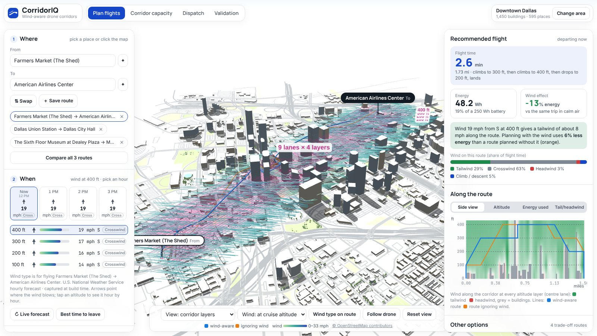
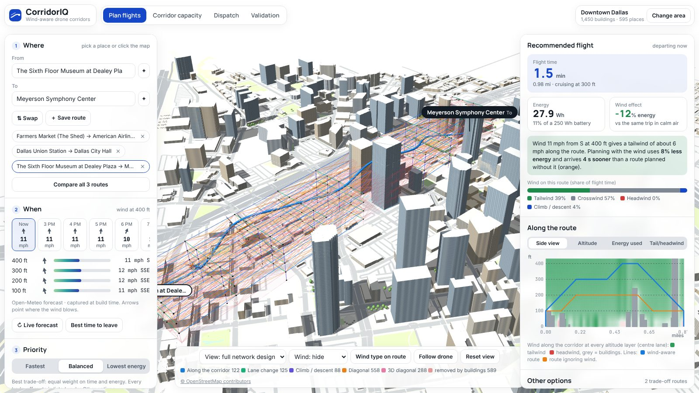
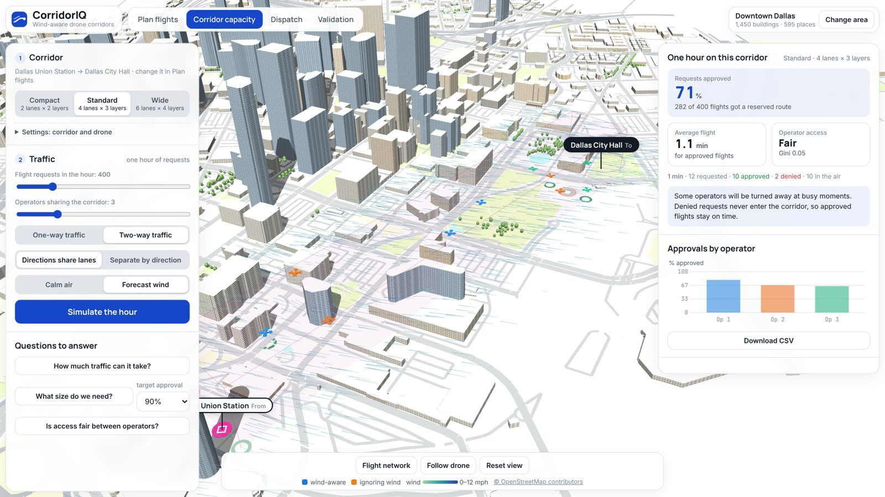

<div align="center">

# CorridorIQ

**Wind-aware planning for urban drone corridors: routes, capacity and dispatch, on real city maps and live weather.**

[](https://github.com/USERNAME/corridoriq/actions/workflows/tests.yml)
[](LICENSE)
[](https://USERNAME.github.io/corridoriq/)

[**Open the live demo**](https://USERNAME.github.io/corridoriq/) · [User guide (slides)](docs/CorridorIQ_guide.pptx) · [Framework figure](docs/figures/framework.pdf)



</div>

## What it does

CorridorIQ answers four questions that drone operators, airspace authorities and city planners ask before low-altitude corridors can open:

| | Question | How |
|---|---|---|
| **Plan flights** | Which route, altitude and departure time use the least time and energy in today's wind? | Time–energy Pareto search over a 3D corridor laid around real buildings, with wind from a live forecast bent around the footprints |
| **Corridor capacity** | How many flights per hour can a corridor approve, and how big must it be? | Shared-intent reservation registry: every request books conflict-free link-time slots or is denied |
| **Dispatch** | When should each flight leave, and on which path, when requests have priorities? | Rolling-horizon priority optimization vs. first come, first served and a hindsight benchmark |
| **Validation** | Does it reproduce the published research? | Re-runs the papers' experiments in the browser next to the published values |

<table><tr>
<td></td>
<td></td>
</tr><tr>
<td align="center">Corridor network as designed: lanes, layers, link types, links removed by buildings</td>
<td align="center">One hour of multi-operator traffic on a shared corridor</td>
</tr></table>

## Try it

- **In the browser:** open the [live demo](https://USERNAME.github.io/corridoriq/), or download [`demo/corridoriq.html`](demo/corridoriq.html) and double-click it. It is one self-contained file: no install, no server. **Live forecast** fetches the current wind; **Change area** loads any OpenStreetMap `.osm` export.
- **From Python** (research code, experiments, figures):

```bash
git clone https://github.com/USERNAME/corridoriq.git
cd corridoriq
pip install -r requirements.txt
pytest -q                          # 25 tests: engine, Python/JavaScript parity, paper reproduction
python make_app.py                 # rebuild the app with a fresh 24-hour wind forecast
python run_wind_routing.py         # Paper 1 experiments -> results/wind_routing
python run_sire_experiment.py      # Paper 2 experiments -> results/sire
```

## Data and models

| Input | Source | Freshness |
|---|---|---|
| Buildings, roads, parks, named places | [OpenStreetMap](https://www.openstreetmap.org/copyright) | snapshot; any area can be loaded |
| Wind at 33, 262, 394 and 591 ft | [Open-Meteo](https://open-meteo.com/), with the [U.S. National Weather Service](https://www.weather.gov/documentation/services-web-api) as backup | hourly forecast, captured at build time and refreshable live |
| Wind around buildings | fast building-aware surrogate (potential flow + wake), not CFD | computed on every plan |
| Link time and energy | published wind-aware routing model (20.42 J/ft, 35 mph, tail/cross/head rule) | computed on every plan |

## Repository layout

```
aamsim/            Python engine: corridor lattice, wind, energy, Pareto routing, SIRE registry, rolling horizon, OSM, weather
demo/              Browser apps: corridoriq.html (product), lab.html (research lab), lab_engine.js (JavaScript twin of aamsim)
docs/              GitHub Pages site (index.html), user-guide slides, figures, screenshots
run_*.py           Paper experiments          make_*.py   App builders
results/           Experiment outputs (CSV and figures)          tests/   Unit, parity and reproduction tests
```

## Research background

Code and simulation for a research program on **shared low-altitude Advanced Air Mobility (AAM) corridors**:

1. **Wind-aware routing** — *Highways in the Sky: UAV Routing under Dynamic Wind Profiles in Low-Altitude Urban Airspace* (TRR).
   Time-dependent Pareto label-correcting search on a 4D corridor network with wind projected onto every link.
2. **Shared-intent reservation (SIRE)** — *Shared Advanced Air Mobility Corridors: Configuration, Capacity, and Demand Management under a Reservation Protocol* (TRBAM-27-05211).
   Sequential limited-disclosure registry of link-time reservations for competing operators.
3. **Rolling-horizon scheduling** — priority-aware rolling-horizon corridor scheduling with full-mission commitments (in preparation).
   Two-stage priority ILP over space-time plans vs. FCFS vs. an offline benchmark.
4. **Bridge: value of wind information** — every mission is planned with four planning winds and flown in the true wind. It measures
   the energy lost to imperfect wind knowledge (Paper 1) and the **reservation drift** that a SIRE registry would have to absorb (Paper 2).

All four run on **one shared core**: the same modular corridor lattice, wind field, energy model and link-time reservation logic.

5. **Real city (downtown Dallas)** — the corridor is laid over OpenStreetMap buildings between Dallas Farmers Market and the
   American Airlines Center (2.46 km, 30–120 m). Every node and link that would hit a building (8 m clearance) is removed, a
   building-aware wind is computed around the real footprints, and missions are planned with the four planning winds and flown in
   the true wind, exactly as in GeoWind2Plan; many-operator SIRE traffic runs on the same city corridor.


## CorridorIQ — the product app (`demo/corridoriq.html`)

CorridorIQ puts the three papers into a plain-language tool for operators, airspace authorities and city planners. It uses no equations and no research vocabulary, and it runs on the same engine as the papers.

| Screen | Question it answers | Engine |
|---|---|---|
| **Plan flights** | Search any named place, or click the map, for From and To. Save several routes and compare them. Pick a departure hour from the live wind forecast and see the wind at 100/200/300/400 ft. The app reports the flight time, the energy (Wh and % of the battery), the cruise altitude, the altitude, energy and wind along the route, and the savings over a plan that ignores the wind. A **Best time to leave** button checks the next 12 hours. | Paper 1 Pareto search on a building-aware corridor and wind field |
| **Corridor capacity** | Choose Compact, Standard or Wide, the requests per hour, 1–10 operators, one-way or two-way traffic, and calm or forecast wind. The app shows the % of requests approved, the average flight time and how fair access is. Three buttons answer *How much traffic can it take?* (capacity at 90% approval), *What size do we need?* (the smallest lanes × layers that reach the target approval) and *Is access fair?* | Paper 2 SIRE registry, run in a Web Worker |
| **Dispatch** | Compares first come, first served with the CorridorIQ optimizer and a hindsight benchmark: requests served, emergency service and waiting time, with a live request board | Paper 3 rolling-horizon ILP schedules exported from Python |
| **Validation** | TRR Table 1 and Figure 7, and TRB Figures 1 and 3, re-run next to the published values | same engine on the papers' open-field geometry |

Every result has a **Download CSV** button. The map shows OpenStreetMap buildings (window textures, shadows), parks, water, road widths and trees, with dark mode. **Change area** loads any `.osm` file.

```bash
python make_app.py                                      # Dallas; captures a 24-h wind forecast (Open-Meteo, NWS fallback)
python make_app.py --osm data/osm/smu_campus.osm.gz --name "SMU campus"
```
Open the built file from disk to get a live forecast (**Live forecast** button). three.js is inlined from `demo/vendor` (MIT), so the single file also runs where outside scripts are blocked (SharePoint or Outlook previews, offline); only the live forecast needs internet. Copies hosted with a strict content policy use the forecast captured at build time.

**AAM Corridor Lab — `demo/lab.html` (research tool).** One page per paper, on any OpenStreetMap area:

| Tab | What you can do | Validation |
|---|---|---|
| 1 · Wind-aware routing (TRR) | design the corridor (module size, lanes N_W, layers N_H, ceiling, take-off rule); pick the wind: Exp 6.2 shear, 6.3 spatial blocks, 6.4 time-varying with a departure slider, building-aware city wind, or a **live weather profile**; see every Pareto route, the time–energy frontier, altitude-band and block usage (Tables 2, 4, 5), and fly any route | **Table 1, Table 3, Figure 7, Figure 8** re-run in the browser with the published values side by side (TRR preset, open field) |
| 2 · Airspace configuration (TRB/SIRE) | set demand, **1–10 operators**, forward/reverse split, shared vs direction-separated link key, dispatch window and pattern, tie-break rule, slot Δt, cruise or wind-affected link times; watch requests get booked (green) or rejected (red) at the pads, drones fly their reservations, and the space-time ledger fill | **Exp 1–4 and the equity test** run in a Web Worker; **Exp 2 recommends the smallest airspace (N_W × N_H) that reaches a target success rate** and applies it |
| 3 · Rolling horizon | replay FCFS, rolling priority ILP and the offline benchmark for several cases on the notebook corridor; request board with the moving freeze/look-ahead window | schedules come from the Python ILP (`export_rh_cases.py`) and pass the independent audit |

Area: *City* uses the loaded OSM buildings (nodes and links that hit a building are removed); *Open field* switches to the paper's own geometry for exact reproduction. **Load .osm area** reads any file exported from openstreetmap.org (Export → Download OSM); **Place Start/Goal** re-lays the corridor where you click. **Live wind**: the page asks Open-Meteo for wind at 10/80/120/180 m when it is opened from disk; the published copy uses the snapshot taken at build time (`python make_lab.py` fetches Open-Meteo, falling back to the U.S. NWS). The browser engine `demo/lab_engine.js` is the twin of the Python package; `tests/test_lab.py` checks it reproduces TRR Table 1 values and makes identical SIRE decisions to Python on 2,000 requests.

```bash
python export_rh_cases.py      # rolling-horizon schedules (Python ILP)  -> demo/rh_cases.json
python make_lab.py             # build demo/lab.html (Dallas; fetches the weather snapshot)
python make_lab.py --osm data/osm/smu_campus.osm.gz --start 32.8395 -96.7890 --goal 32.8445 -96.7790 --name "SMU campus"
python -c "from aamsim.weather import fetch_profile; print(fetch_profile(32.78, -96.80))"   # live wind profile
```

**Other demos**
* `demo/city.html` — 3D Dallas: buildings, roads, your corridor network, wind streamlines, quadcopters flying each planned route,
  Start/Goal markers, wind dial, random tail/head/crosswind missions, energy/altitude/ground-speed/wind-on-track charts, and a
  corridor-traffic mode running the SIRE registry live in the browser.
* `demo/index.html` — replays the three paper experiments (abstract lattice, space-time ledgers, request boards).

## Real-city layer

```bash
python run_geo_mission.py --direction 165 --speed 4          # one headwind mission, printed
python run_geo_mission.py --missions 48 --speeds 2 4 8         # GeoWind2Plan-style table by wind class
python run_geo_mission.py --fetch --bbox <min_lon min_lat max_lon max_lat> --start <lat lon> --goal <lat lon> --osm data/osm/mycity.osm
python make_geo_demo.py                                         # rebuild demo/city.html
```
* `aamsim/geo.py` — OSM parsing (heights from `height`, `building:levels` × 3.5 m, or a type default; building parts), corridor
  placement along a start→goal axis, rasterised building heights, removal of blocked nodes/links, launch pads.
* `aamsim/urbanwind.py` — building-aware wind surrogate: per-altitude potential flow around the solid footprints (red-black SOR),
  a wake deficit behind buildings and a power-law shear profile. It reproduces the qualitative structure (canyon speed-up,
  wakes, turning) in about a second; it is **not CFD**. Replace it with CFD or LES output through `aamsim.wind.wind_from_arrays`
  for a paper result.
* `aamsim/geo_plan.py` — the four planning winds (ground truth; a coarse weather-model forecast with a 15° direction error and
  −15% speed bias and no buildings; the height-only profile; zero wind), energy-optimal planning, evaluation in the truth.
  Energy and travel time use the TRR equations exactly (Eq. 20 projection, β = λ²); `model="crab"` is an optional extension in which
  crosswinds cost energy through a crab angle.
  wind dial moves. `tests/test_geo.py` checks the browser engine against Python (node wind to 1e-12, identical routes up to
  exact ties, identical SIRE accept/reject decisions).

Map data © OpenStreetMap contributors, available under the Open Database License (ODbL).

---

## Installation

```bash
pip install -r requirements.txt
```

Python ≥ 3.10. `numba` is optional; without it SIRE falls back to a vectorized numpy search, which is slower but gives identical results (this is tested).

## Code

```
run_wind_routing.py       Paper 1 experiments (TRR Sec. 6.2-6.5)
run_sire_experiment.py    Paper 2 experiments (TRB Figs. 1-4) + equity and wind extensions
run_rolling_horizon.py    Paper 3 design grid (FCFS / rolling ILP / offline)
run_wind_belief.py        Bridge experiment: plan with a belief, fly in the truth
summarize_results.py      prints tables for any result CSV
make_demo.py              builds demo/index.html (paper replays)
make_lab.py               builds demo/lab.html (the AAM Corridor Lab: all three papers on an OSM city)
export_rh_cases.py        runs rolling-horizon cases with the Python ILP for the lab
make_geo_demo.py          builds demo/city.html (earlier single-mission city demo)
run_geo_mission.py        real-city wind-information experiment (OSM buildings)
aamsim/
  corridor.py             modular prism lattice (edges, face and body diagonals), portals
  wind.py                 wind fields, TRR link projection (Eqs. 14-25), synthetic truth, planning beliefs
  energy.py               vehicle model, baseline and phase-dependent energy (Eqs. 10-13, 26-33)
  pareto.py               time-dependent bi-objective label-correcting search (Algorithms 1-2)
  sire.py                 SIRE registry, operator route search on (node, slot), KPIs (SR, Gini, cascade)
  rolling.py              port of the priority rolling-horizon ILP notebook, with independent audit
  belief.py               four planning winds, mission sampling, evaluation in the truth
  plotting.py             paper figure style (colour-blind-validated palette)
  geo.py                  OpenStreetMap buildings, corridor over a real city
  urbanwind.py            building-aware wind surrogate (potential flow + wakes + shear)
  geo_plan.py             four planning winds, energy-optimal routes, evaluation in the truth
  weather.py              live wind profiles (Open-Meteo 10/80/120/180 m, U.S. NWS fallback)
demo/lab_engine.js        browser twin of the engine (corridor builder, TRR winds, Pareto, SIRE, OSM import)
demo/geo_engine.js        browser twin of urbanwind / geo_plan / sire
data/osm/dallas.osm.gz       OpenStreetMap extract of downtown Dallas (ODbL)
tests/test_core.py        geometry, reproduction of published values, reservation exclusivity, audit
demo/template.html        viewer; make_demo.py injects the data and writes demo/index.html
```

## Usage

### Paper 1 — wind-aware routing

```bash
python run_wind_routing.py --experiment all
python run_wind_routing.py --experiment orientation --phase-dependent   # climb + take-off energy terms
python run_wind_routing.py --experiment congestion --lanes 4 --reps 10
```
Output: `results/wind_routing/{orientation,spatial,temporal,congestion}.csv` and `figures/`. Each row reports the number of Pareto paths,
mean travel time and energy, ascents/descents, and the share of time and energy by altitude band and by longitudinal block (Tables 1–5).

### Paper 2 — SIRE

```bash
python run_sire_experiment.py --experiment demand    --reps 30 --workers 8
python run_sire_experiment.py --experiment geometry  --reps 30 --workers 8
python run_sire_experiment.py --experiment all       --reps 5            # quick look
```
| experiment | varies | paper |
|---|---|---|
| `demand` | 100 … 4,000 trips | Fig. 1 |
| `geometry` | lateral modules N_W 1–4 × altitude modules N_H 1–4 at 2,000 trips | Fig. 2 |
| `direction` | forward/reverse split × shared (undirected) vs direction-separated key | Fig. 3 |
| `dispatch` | dispatch window 5–60 min × uniform vs peak | Fig. 4 |
| `equity` | same-minute tie-break: operator id (published) vs lottery vs rotating | new |
| `wind` | link times from the TRR shear wind (tail vs head) | new |

Replicates use common random numbers across cells (`seed = 1000 + rep`). A 2,000-trip replicate takes about 1–2 s with numba.

### Paper 3 — rolling horizon

```bash
python run_rolling_horizon.py --design base  --seeds 3
python run_rolling_horizon.py --design quick --seeds 5  --workers 4
python run_rolling_horizon.py --design full  --seeds 30 --workers 8     # the notebook's full grid
```
Every schedule is rebuilt from geometry and audited (no shared resource token, request windows, freeze rule) before metrics are saved.
`summary.csv` holds paired ILP − FCFS and offline − ILP differences with bootstrap 95% CIs over seeds. Large loads (≥ 200 requests) solve many MILPs
with SciPy/HiGHS and can take a long time per seed, as in the original notebook.

### Bridge — value of wind information

```bash
python run_wind_belief.py --missions 256 --wind-speed 15 --workers 8
python run_wind_belief.py --mission 0                       # one mission, printed
python run_wind_belief.py --wind-speed 8 --select time       # pick the fastest Pareto route instead of the cheapest
python run_wind_belief.py --model continuous                 # crosswind and oblique components act on every link
```
| method | planning wind |
|---|---|
| Ground truth | the true field (perfect information reference) |
| Forecast | truth with a speed bias (±15%), a direction error (σ = 15°), smooth spatial error and a 6-min lag |
| Profile wind | one sounding at departure, averaged over each altitude layer and applied uniformly |
| Wind-agnostic | zero wind |

Output: `results/wind_belief/missions_<speed>mph_<rule>.csv` (one row per mission and method) and `summary_<...>.csv`, a table in the
style of GeoWind2Plan: Wh/km (mean, sd), extra energy vs ground truth, extra time, absolute arrival error, the reservation slot shift
and the share of links that leave their reserved slot, mean altitude and ground speed, reported for all, tailwind, headwind and crosswind missions.

### Demo

```bash
python make_demo.py              # runs small scenarios of every study (~2-3 min), writes demo/index.html
python make_demo.py --from-json  # rebuild the HTML only
```
Open `demo/index.html` in a browser. Tabs: wind routing, SIRE reservations, rolling horizon, wind information.

### Tests

```bash
python -m pytest -q tests
```

---

## Reproduction of published results

Values produced by this repository against the published or submitted numbers.

**Paper 1 (TRR), Table 1, altitude-varying wind**

| wind | time (min) repo / paper | energy (kWh) repo / paper |
|---|---|---|
| none | 9.74 / 9.74 | 0.1702 / 0.170 |
| 0° tail | 5.50 / 5.50 | 0.0539 / 0.054 |
| 45° | 6.32 / 6.30 | 0.0705 / 0.070 |
| 135° | 10.03 / 9.88 | 0.1772 / 0.174 |
| 180° head | 16.29 / 16.29 | 0.4775 / 0.477 |
| 225° | 9.95 / 10.04 | 0.1738 / 0.175 |
| phase-dependent: none / tail / head | 9.74 / 5.50 / 16.29 (same) | 0.187 / 0.071 / 0.495 vs 0.187 / 0.071 / 0.495 |

Spatial blocks (Table 3): tail 5.95 min / 0.0635 kWh with 2 Pareto paths (paper 5.95 / 0.063 / 2); 45° 6.73 / 0.080 (paper 6.71 / 0.079).
The 180° spatial case gives 15.86 min / 0.454 kWh against 17.51 / 0.559 in the paper; the block-to-node assignment at block boundaries
is the likely difference and is set in `aamsim.wind.trr_spatial_wind`. The congestion experiment (6.5) depends on the lane count, which
the paper does not state; use `--lanes`.

**Paper 2 (TRB), Figure 1** (10 replications; paper uses 30)

| demand | SR repo / paper | accepted repo / paper | Gini repo / paper |
|---|---|---|---|
| 200 | 99.8% / 99.57% | | |
| 600 | 89.5% / 89.68% | | |
| 1,000 | 69.9% / 69.97% | | 0.183 / 0.183 |
| 2,000 | 36.6% / 36.86% | 731 / 737 | 0.477 / 0.478 |
| 4,000 | 17.5% / 17.68% | 699 / 707 | 0.638 / 0.636 |

Accepted-trip travel time 585 s at low demand and 2.2% inflation at 2,000 trips (paper 585 s, 2.30%). Figure 3, 50/50 split: shared
44.3% vs separated 72.5% (paper 44.20% / 72.17%). The notebook's reproduction reference (D = 2,000, replicate 1, SR = 0.3645) is
reproduced exactly and is a unit test.

**Paper 3** — the 50-request pilot of the notebook is reproduced (ILP and offline mean delay 0.016 min, max 0.2 min; all requests served).

## Notes on the TRR equations (implemented exactly as published)

The energy and travel-time model follows TRR Eqs. 10–33 without changes: ground speed by the piecewise rule of Eq. 20,
λ = v_UAV/v (Eq. 25), β = λ² (Eq. 24), d = d̄λ and e = ēβ (Eqs. 26–27), ē = 20.42 J/ft × L, v_UAV = 35 mph; phase-dependent mode adds
α_climb = 1 + k sin φ with k = 0.2 and E_TO = 10% of the no-wind route energy (Sec. 5.4). Reproduced: no wind 9.74 min / 0.170 kWh,
tail 5.50 / 0.054, head 16.29 / 0.477, phase-dependent 0.187 / 0.071 / 0.495 kWh. Points to check in the manuscript:

1. Eq. 23 states E ∝ v_ij², but Eq. 24 uses β = (v_UAV / v_ij)², the inverse. The code follows Eq. 24, which is what the published
   tables use; the text between Eqs. 21–24 should be reworded so the derivation leads to Eq. 24 (e.g., power at constant airspeed times
   a flight time that scales with 1/v_ij gives β = λ; the drag-squared argument gives λ²).
2. Eq. 32 writes sin(θ_ij), but θ_ij is the heading (Eq. 14); the text defines the ascent angle φ_ij (Eq. 31). The code uses φ_ij.
3. Eqs. 14 and 17b use tan⁻¹(Δy/Δx); the quadrant-aware atan2 is required (and used) for headings and wind directions in all quadrants.
4. Table 1 reports 6.30 min at 45° and 6.38 min at 315°; the geometry and Eq. 20 are symmetric about the corridor axis, so both give 6.32 min here.
5. The crosswind-crab model used briefly in an earlier city demo is **not** used anywhere by default; `model="crab"` remains available as an
   explicit option only.

## Modelling notes and limits

* Link travel time and energy follow the TRR equations: the nodal wind is averaged on the link and projected on the link heading. Under the
  paper's rule, winds more than 45° off the track do not change ground speed; `model="continuous"` uses the full along-track component.
* SIRE routes depart exactly at the intended slot (no airborne waiting), keyed on the undirected physical link (or the directed arc for
  the separated rule); a link held for τ seconds blocks `max(1, ceil(τ/Δt))` slots.
* Routes in Papers 1 and 3 may not land at an intermediate ground node. SIRE keeps the TRB notebook's rule (only ground-to-ground links removed).
* The "ground truth" wind in the bridge experiment is **synthetic** (power-law shear, smooth building-wake bumps, veer, drift). It is a
  controlled stand-in so the planning beliefs have structure to get wrong. For a paper result, replace it with interpolated
  observations or model output (e.g. HRRR analysis vs. forecast, or CFD) through `aamsim.wind.wind_from_arrays`.
* Rolling horizon: `rolling.py` implements the 14 Oct 2026 notebook (priority ILP). The earlier draft's learned afterstate critic and Lagrangian
  decomposition are not implemented here.

## How to cite

If you use CorridorIQ, its code or its results, please cite the software and the related papers. GitHub's **Cite this repository** button (from [`CITATION.cff`](CITATION.cff)) gives APA and BibTeX.

```bibtex
@software{ahmed2026corridoriq,
  author = {Ahmed, Rawda and Abdelghany, Khaled},
  title  = {CorridorIQ: Wind-aware planning for urban drone corridors},
  year   = {2026},
  url    = {https://github.com/USERNAME/corridoriq}
}
@article{ahmed_highways_sky,
  author = {Ahmed, Rawda and Abdelghany, Khaled},
  title  = {Highways in the Sky: UAV Routing under Dynamic Wind Profiles in Low-Altitude Urban Airspace},
  journal = {Transportation Research Record},
  note   = {Under review}
}
@inproceedings{ahmed_shared_corridors,
  author = {Ahmed, Rawda and Abdelghany, Khaled},
  title  = {Shared Advanced Air Mobility Corridors: Configuration, Capacity, and Demand Management under a Reservation Protocol},
  booktitle = {Transportation Research Board Annual Meeting},
  note   = {TRBAM-27-05211}
}
```

## Acknowledgments and related work

- The city-scale 3D presentation of buildings, wind and drone routes was inspired by **GeoWind2Plan**: S. Qin, Y. Zhao, F. Lyu, D. Zhou, J. Yao, X. Liu, A. Anandkumar, L. L. Wang and X. Xiao, *GeoWind2Plan: Mission-Time 3D Urban Wind Prediction for Energy-Efficient UAV Planning* (2026). [Project site](http://geowind2plan.com/) · [Code](https://github.com/DUAL-Xiao/GeoWind2Plan). CorridorIQ uses its own models (corridor lattice, wind surrogate, energy model, reservation registry, dispatch optimizer) and reuses no GeoWind2Plan code or data.
- Map data © [OpenStreetMap contributors](https://www.openstreetmap.org/copyright), available under the Open Database License (ODbL).
- Weather data from [Open-Meteo](https://open-meteo.com/) (CC BY 4.0) and the [U.S. National Weather Service](https://www.weather.gov/).
- 3D rendering with [three.js](https://threejs.org/) (MIT), included in `demo/vendor`.

## Copyright and license

Copyright © 2026 Rawda Ahmed, Southern Methodist University. Released under the [MIT License](LICENSE).
